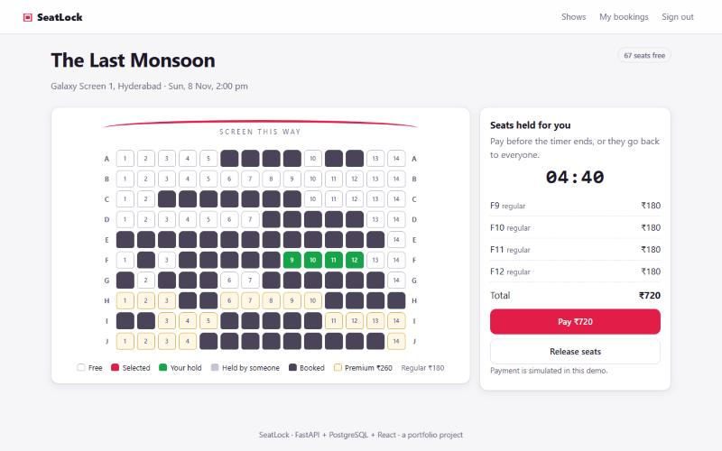
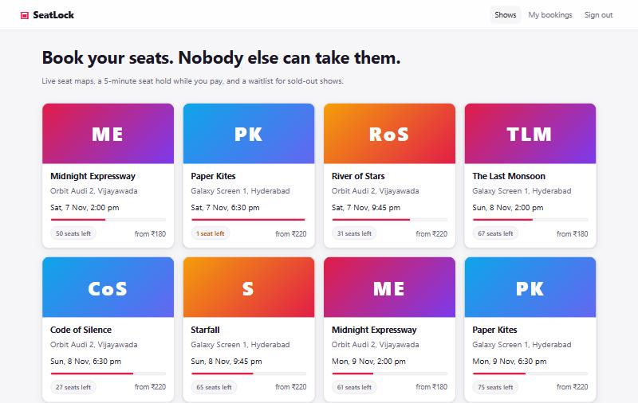
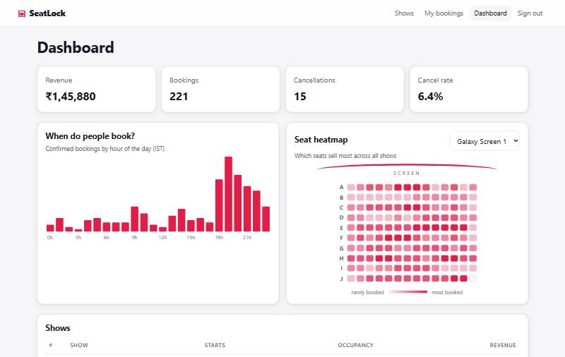
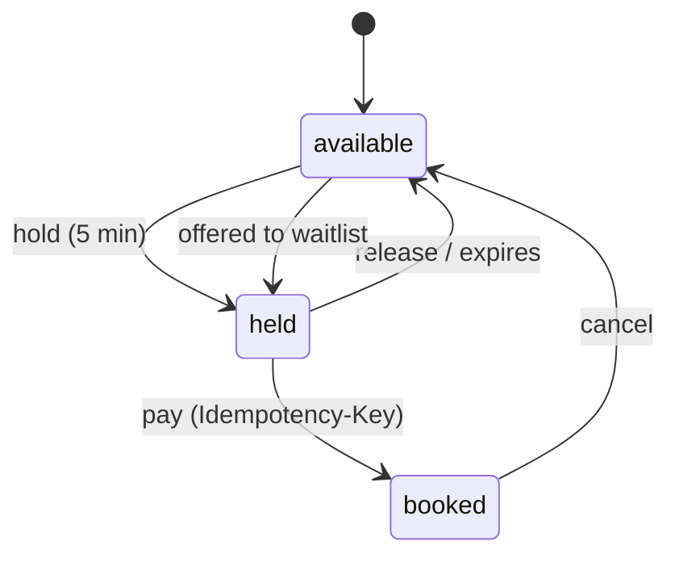
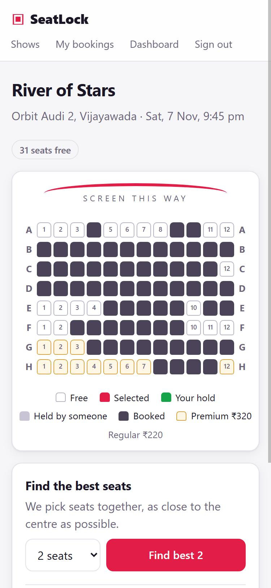

# SeatLock: seat booking that can't double-book


A movie seat booking system (**FastAPI · PostgreSQL · React**) built around the hardest problem in any booking app: **two people must never get the same seat**, even when they click at exactly the same moment.



> **Proof, not a promise:** a test sends **200 users at one seat at the same instant**. Every run, exactly **1** gets it and **199** are told it is taken, with zero errors. ([see below](#proof-200-people-one-seat))

## What it does

| Feature | How it works |
|---|---|
| **No double booking** | Each seat of each show is one row in `show_seats`. Every change locks that row first (`SELECT … FOR UPDATE`) inside a transaction. |
| **5-minute seat hold** | Picking seats creates a *hold* with an expiry time. A background sweeper frees expired holds every 2 s, and an expired seat is treated as free right away, even before the sweeper runs. |
| **Smart group seating** | "Find best 4" picks 4 adjacent seats as close as possible to the centre of the sweet-spot row, using a SQL *gaps-and-islands* query. |
| **Live seat map** | Seats turn grey for everyone the moment someone holds them (WebSockets), with no refresh. |
| **Safe payment retry** | "Pay" sends an `Idempotency-Key`. Double clicks, retries or 20 tabs at once all return the **same single booking**. |
| **Waitlist** | Sold out? Join the queue. When someone cancels, or a hold expires, the seats are held for the next person, strictly first-come-first-served. |
| **Admin analytics** | Revenue ranking per show (`RANK() OVER`), occupancy, bookings by hour, a running revenue total, and a seat heatmap showing which seats sell first. |

<p>
  
  
</p>

## How is this different from BookMyShow?

It isn't a competitor. BookMyShow is a whole business with payments, partners and millions of users. SeatLock focuses on the **engineering core** of any booking product and shows it working under load:

- concurrency control with PostgreSQL row locks and a consistent lock order (no deadlocks),
- seat holds that expire on time, with no cron job and no stale seats,
- idempotent payments, the way real payment APIs (Stripe, Razorpay) work,
- a fair waitlist, and a seat-picking algorithm written in SQL,
- **tests that prove** all of the above, run automatically on every push (GitHub Actions).

## Proof: 200 people, one seat

Two kinds of tests check this:

**1. Automated test suite (31 tests, `pytest`).** `tests/test_concurrency.py` fires requests at the same moment with `asyncio.gather`, and the app runs them on up to 30 database connections in parallel:

| Test | Result |
|---|---|
| 200 users hold the same seat | exactly 1 × `201 Created`, 199 × `409 Conflict` |
| 60 users grab overlapping 3-seat blocks | no seat is ever shared, no deadlocks, no 500s |
| 40 users press "best 2 seats" on an 18-seat show | at most 9 winners, all seats different |
| 20 "Pay" clicks on one hold (same and different keys) | 1 booking, every tab gets the same one |

The concurrency tests were run 10 times in a row: **10 / 10 passed**.

**2. Live load test over real HTTP** against the running server (`python -m scripts.race_test -n 200`):

```
200 users -> seat A3 of 'Midnight Expressway' (show 1)
  201 Created (won the seat): 1
  409 Conflict (seat taken) : 199
  anything else             : 0
  all 200 requests answered in 3.83 s
```

### A real race condition the tests caught

The first version of the hold query locked seat rows **and joined the `holds` table in the same statement**. Under load, the 200-user test crashed: some requests saw a held seat whose hold looked *missing*.

**Why:** in PostgreSQL's default `READ COMMITTED` mode, a transaction that waits for a row lock re-reads the **locked row** when it continues, but rows from **joined tables** still come from its older snapshot. So the winner's new hold was invisible to the losers.

**Fix:** lock the seat rows first, then read hold details in a **separate statement**, which takes a fresh snapshot. The comment in [`booking.py`](backend/app/services/booking.py) explains it where it happens.

## How the locking works

```mermaid
sequenceDiagram
    participant A as User A
    participant B as User B
    participant DB as PostgreSQL
    A->>DB: BEGIN; SELECT seat B3 FOR UPDATE
    B->>DB: BEGIN; SELECT seat B3 FOR UPDATE
    Note over B,DB: B waits: A holds the row lock
    A->>DB: UPDATE B3 -> held by A; COMMIT
    DB-->>B: lock granted, row re-read: B3 is held
    B->>DB: ROLLBACK -> 409 "seat taken"
```

Rules that keep it correct (all in [`backend/app/services/booking.py`](backend/app/services/booking.py)):

1. A seat's state changes **only** while its `show_seats` row is locked.
2. Rows are always locked **in `seat_id` order**, so overlapping requests queue up instead of deadlocking.
3. A hold row is locked **before** its seat rows, everywhere.
4. The database itself rejects impossible states: `CHECK ((status = 'held') = (hold_id IS NOT NULL))`.



## SQL worth a look

- **Gaps and islands** for adjacent seats ([`seating.py`](backend/app/services/seating.py)): `seat_number - ROW_NUMBER() OVER (PARTITION BY row ORDER BY seat_number)` is the same for every seat in a run of consecutive free seats.
- **Window functions** for reports ([`analytics.py`](backend/app/services/analytics.py)): `RANK() OVER (ORDER BY revenue DESC)`, running totals with `SUM() OVER (ORDER BY day)`, `COUNT(*) FILTER (WHERE …)`.
- **`FOR UPDATE SKIP LOCKED`** for the sweeper and the waitlist queue, so workers never block each other.
- **Partial indexes** (`WHERE status = 'active'`) and a **partial unique index**, so a user can be in a show's waitlist only once at a time.
- **Unique constraints as business rules:** `UNIQUE (user_id, idempotency_key)` and `bookings.hold_id UNIQUE` (one hold, at most one booking).

The whole schema is one readable file: [`backend/sql/schema.sql`](backend/sql/schema.sql).

## Tech stack

| Layer | Technology |
|---|---|
| Backend | Python 3.12, FastAPI, async psycopg 3 (raw SQL, connection pool), JWT login, bcrypt |
| Database | PostgreSQL 17 |
| Frontend | React 19, React Router, Vite. Plain CSS (grid, custom properties, dark mode), seat map in HTML/CSS, charts in SVG |
| Real time | WebSockets |
| Testing / CI | pytest (31 tests incl. concurrency), oxlint, GitHub Actions with a PostgreSQL service |



## Run it locally

You need **Python 3.12+**, **Node 20+** and **PostgreSQL 13+**.

```bash
# 1. database (as a PostgreSQL superuser)
psql -c "CREATE ROLE seatlock LOGIN PASSWORD 'seatlock_dev_pw' CREATEDB;"
psql -c "CREATE DATABASE seatlock OWNER seatlock;"
psql -c "CREATE DATABASE seatlock_test OWNER seatlock;"

# 2. backend
cd backend
python -m venv .venv && source .venv/bin/activate    # Windows: .venv\Scripts\activate
pip install -r requirements.txt
cp .env.example .env                                  # check DATABASE_URL (default port 5433)
python -m scripts.init_db --reset
python -m scripts.seed                                # demo venues, shows, 236 bookings
python run.py                                         # API on http://127.0.0.1:8030, docs at /docs

# 3. frontend (new terminal)
cd frontend
npm install
npm run dev                                           # http://localhost:5180
```

**Demo logins** (created by the seed script, local demo data only):

| Role | Email | Password |
|---|---|---|
| User | `demo@seatlock.test` | `Demo@1234` |
| Admin | `admin@seatlock.test` | `Admin@1234` |

The login page also has **Demo user** and **Demo admin** buttons.

**Tests:** `cd backend && python -m pytest -q` (uses the `seatlock_test` database).

<br clear="right">

## API

Interactive docs at `/docs` (Swagger UI). Main endpoints:

| Method | Path | What it does |
|---|---|---|
| `POST` | `/api/auth/register`, `/api/auth/login` | Get a JWT |
| `GET` | `/api/shows`, `/api/shows/{id}` | Shows, and the seat map with live status |
| `POST` | `/api/shows/{id}/holds` | Hold chosen seats for 5 minutes |
| `POST` | `/api/shows/{id}/holds/best` | Hold the best N adjacent seats |
| `POST` | `/api/holds/{id}/confirm` | Pay (header `Idempotency-Key`) and get a booking |
| `DELETE` | `/api/holds/{id}` | Release a hold |
| `POST` | `/api/bookings/{id}/cancel` | Cancel; the seats go to the waitlist |
| `POST` | `/api/shows/{id}/waitlist` | Join the waitlist |
| `WS` | `/api/ws/shows/{id}` | Live seat changes |
| `GET` | `/api/admin/dashboard`, `/api/admin/venues/{id}/heatmap` | Analytics (admin only) |

## Project structure

```
backend/
  app/
    services/booking.py     holds, bookings, cancellations, expiry, waitlist (the locking lives here)
    services/seating.py     best adjacent seats (gaps and islands)
    services/analytics.py   admin reports (window functions)
    routers/                HTTP + WebSocket endpoints
    realtime.py             WebSocket hub
  sql/schema.sql            tables, constraints, indexes
  scripts/                  init_db, seed, race_test (live load test)
  tests/                    31 pytest tests
frontend/src/
  pages/                    Shows, SeatPage, MyBookings, Admin, Login
  components/               SeatMap, Countdown
```

## What I would add next

- **Several server instances:** move the WebSocket fan-out to PostgreSQL `LISTEN/NOTIFY` or Redis pub/sub, so every instance hears every seat change.
- **A real payment gateway** (for example Razorpay test mode), passing the same idempotency key through.
- **Rate limiting** on hold requests, so one user cannot lock a whole show.

---

Built by **Vunnam Yasaswi** · [github.com/124Yasaswi](https://github.com/124Yasaswi)
